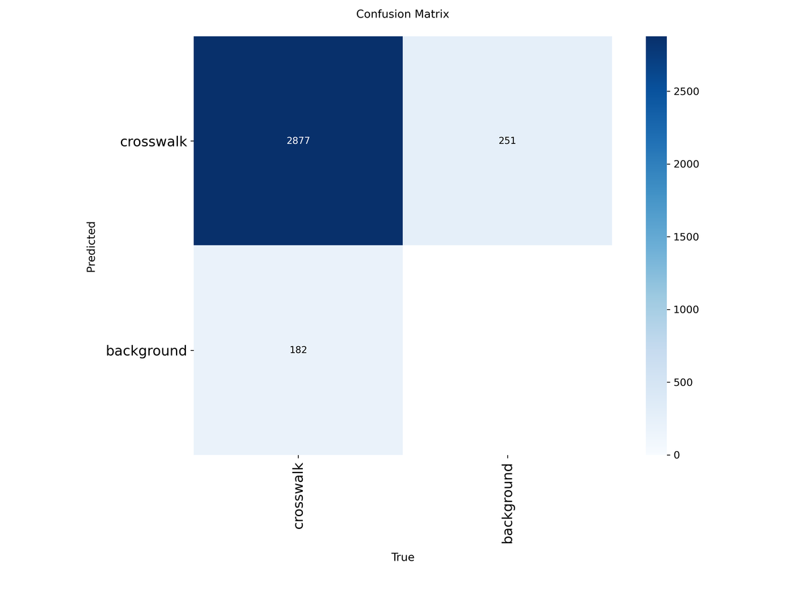
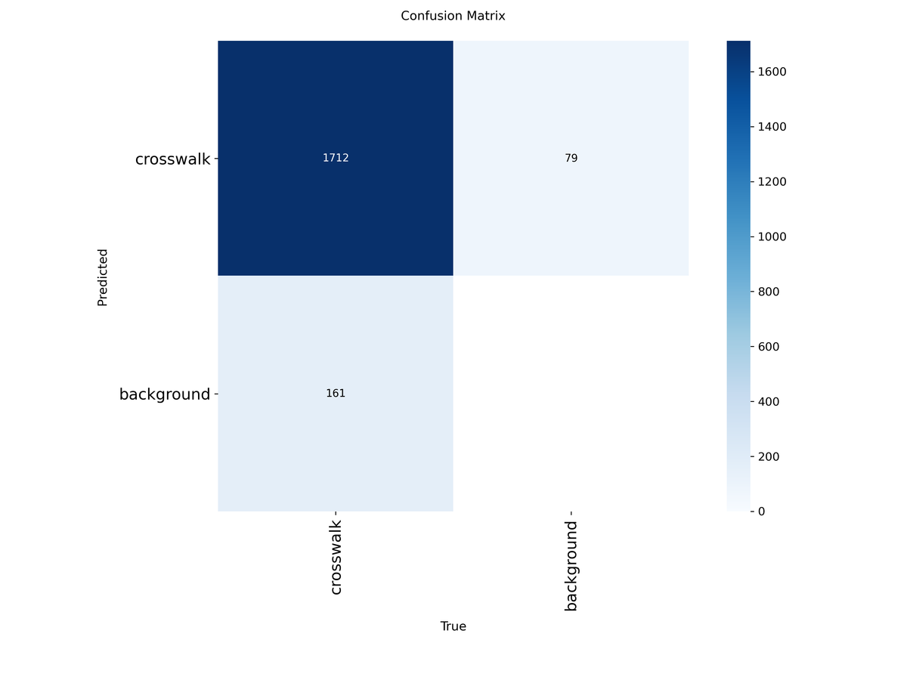
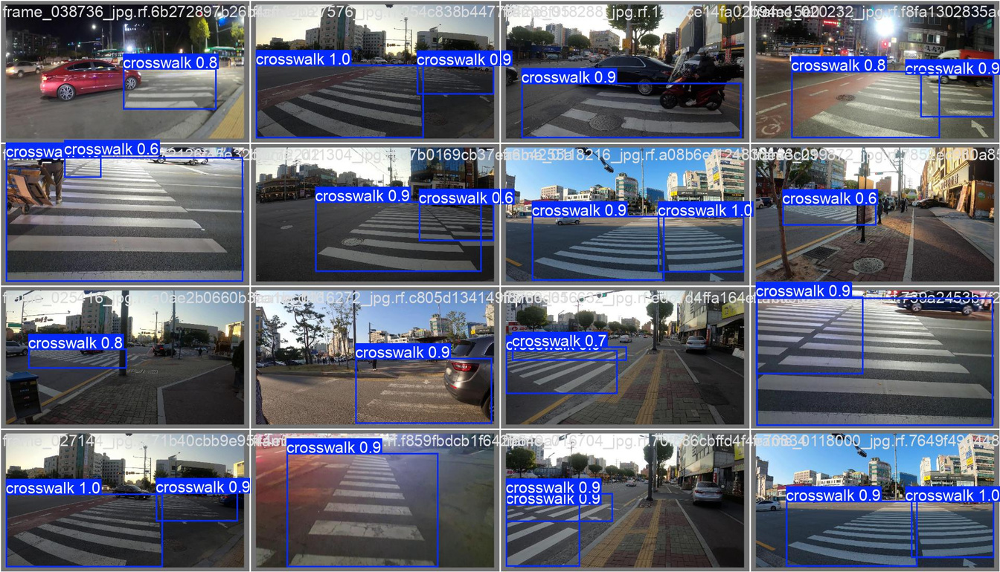
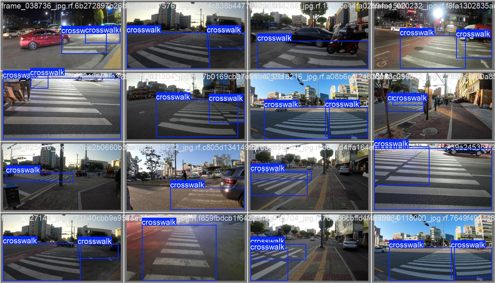
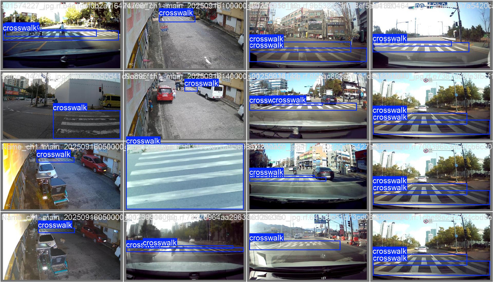
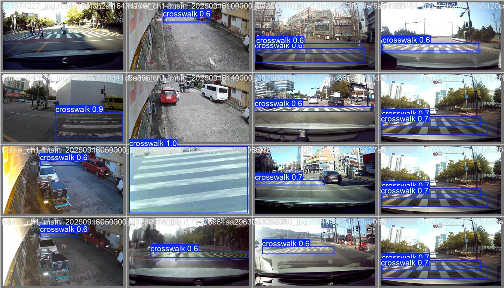

<div align="center">

# 🚸 Detecção de Faixa de Pedestre com YOLO

Detecção de faixas de pedestre (zebradas) em imagens de rua, com comparação entre gerações do YOLO.

<a href="https://colab.research.google.com/github/DaviPRabelo/CrossWalkDetection/blob/main/CrosswalkDetection.ipynb"></a>


<a href="https://app.roboflow.com/workspace-hjntk/crossalkzebra-sdro0"></a>

</div>

---

## 📦 Dataset

**Roboflow:** <https://app.roboflow.com/workspace-hjntk/crossalkzebra-sdro0>

| Campo | Valor |
|---|---|
| Workspace | `workspace-hjntk` |
| Projeto | `crossalkzebra-sdro0` |
| Versão usada no notebook | `3` |
| Classe | `crosswalk` |
| Imagens | 6929 |

O dataset tem imagens variadas de faixas (câmeras de veículo, câmeras de rua, fotos aproximadas) e também imagens **sem** faixa, para o modelo aprender a não disparar em qualquer padrão listrado.

## 🎯 Objetivos

- Reformular o dataset.
- Melhorar as métricas em relação à primeira versão do projeto.

## 📊 Resultados

Todos os modelos são versões *nano*, treinados por 50 épocas com imagens de 640×640.

| Dataset | Imagens | Modelos testados | Melhor modelo | `conf` | Precisão | Recall | F1-Score | Acerto global* |
|---|---:|---|---|:-:|---:|---:|---:|---:|
| Antigo | 8800 | — | YOLOv8 | 0.25 | 91,9% | 94,3% | 93,0% | 86,9% |
| V1 (otimizado) | 5290 | YOLOv8n, YOLO11n | **YOLOv8n** | 0.45 | **97,5%** | 93,4% | **95,4%** | **91,1%** |
| V2 (detalhado) — **atual** | 6929 | YOLOv8n, YOLO11n, YOLO12n | **YOLO11n** | 0.50 | 95,6% | 91,4% | 93,4% | 87,7% |

<sub>* Acerto global = TP / (TP + FP + FN), calculado a partir da matriz de confusão (não há verdadeiros negativos em detecção de objetos).</sub>

### Matrizes de confusão

| Dataset antigo (conf=0.25) | Dataset V1 (conf=0.45) | Dataset V2 (conf=0.50) |
|:-:|:-:|:-:|
|  |  |  |
| TP 2877 · FP 251 · FN 182 | TP 1658 · FP 43 · FN 118 | TP 1712 · FP 79 · FN 161 |

### Testes por modelo

Métricas de validação de cada modelo, tiradas dos logs de treino. Todos usaram 50 épocas e imagens de 640×640.

| Modelo | Dataset | Pesos iniciais | Imagens / instâncias (val) | Precisão | Recall | mAP50 | mAP50-95 | Parâmetros | GFLOPs | Tempo de treino |
|---|---|---|:-:|---:|---:|---:|---:|---:|---:|---:|
| YOLOv5n | V1 (`Crossalk_Zebra`, versão 9 no Roboflow) | `yolov5n.pt` | 1566 / 1830 | 0.962 | 0.930 | 0.969 | 0.870 | 1,76 M | 4,1 | 0,73 h |
| YOLO11n | V2 (`CrossalkZebra`, versão 3 no Roboflow) | `yolo11n.pt` | 1593 / 1873 | **0.957** | **0.907** | **0.966** | **0.840** | 2,58 M | 6,3 | 0,97 h |
| YOLO12n | V2 (`CrossalkZebra`, versão 3 no Roboflow) | `yolov12n.yaml` (sem pré-treino) | 1593 / 1873 | 0.938 | 0.878 | 0.951 | 0.808 | 2,51 M | 5,8 | 1,29 h |

Validações com limiar de confiança fixo:

| Modelo | Dataset de validação | `conf` | Imagens / instâncias | Precisão | Recall | mAP50 | mAP50-95 |
|---|---|:-:|:-:|---:|---:|---:|---:|
| YOLO11n | V2 | 0.50 | 1593 / 1873 | 0.954 | 0.912 | 0.950 | 0.868 |
| YOLO12n | Antigo (`MergeCroossing-7`) | 0.45 | 2229 / 3059 | 0.871 | 0.655 | 0.779 | 0.614 |

Observações:

- O YOLOv5n foi treinado com o repositório original [`ultralytics/yolov5`](https://github.com/ultralytics/yolov5). Os demais foram treinados com o pacote `ultralytics`.
- O YOLO12n foi treinado com o fork [`sunsmarterjie/yolov12`](https://github.com/sunsmarterjie/yolov12) a partir do `.yaml`, ou seja, sem pesos pré-treinados no COCO. Isso o deixa em desvantagem em relação ao YOLO11n.
- O YOLOv5n foi validado em outra versão do dataset (1830 instâncias), então os números dele não são diretamente comparáveis aos do V2.
- Com `conf` fixo, o mAP fica distorcido, porque a curva precisão × recall é cortada. Para comparar modelos, use as métricas da primeira tabela. O `conf` serve para escolher o limiar de uso.
- O YOLOv8n também foi testado no V1 e no V2 (veja a tabela de resultados acima), mas os logs individuais dele não estão no notebook de testes.

### Labels × predições

**Dataset V1 (YOLOv8n)**

| Labels | Predições |
|:-:|:-:|
|  |  |

**Dataset V2 (YOLO11n)**

| Labels | Predições |
|:-:|:-:|
|  |  |

## 🧪 Histórico dos testes

### Dataset antigo

- 8800 imagens. O YOLOv8 teve o melhor resultado.
- Um YOLO12n validado nesse dataset com `conf=0.45` ficou bem abaixo: recall de 65,5% e mAP50-95 de 0.614.
- **Problema:** faixas distantes quase não eram detectadas, porque ficavam pequenas demais na resolução de treino (640×640).
- **Solução:** remover as labels pequenas demais e montar um dataset novo, em duas versões.

### Dataset V1 (otimizado)

- 5290 imagens, só de faixas brancas e pretas.
- Disponível no [Roboflow Universe](https://universe.roboflow.com/workspace-hjntk/crossalk_zebra-hbxfl).
- YOLOv8n e YOLO11n, 50 épocas. O **YOLOv8n** foi melhor.
- Melhor limiar de confiança na validação: `conf=0.45`.
- Também houve um teste com YOLOv5n na versão 9 deste dataset: mAP50 de 0.969 e mAP50-95 de 0.870.

### Dataset V2 (detalhado)

- 6929 imagens, com cenários mais variados e imagens sem faixa.
- Disponível no [Roboflow](https://app.roboflow.com/workspace-hjntk/crossalkzebra-sdro0).
- YOLOv8n, YOLO11n e YOLO12n, 50 épocas. O **YOLO11n** foi melhor: mAP50-95 de 0.840, contra 0.808 do YOLO12n.
- Melhor limiar de confiança na validação: `conf=0.50`.

## ✅ Conclusões

Da V1 para a V2 os números absolutos caíram um pouco, cerca de 2 a 3 pontos percentuais (precisão de 97,5% para 95,6%). Essa queda não é uma piora: a V2 inclui cenários mais difíceis e imagens sem faixa, então as métricas refletem melhor o uso real. O modelo treinado na V2 é **mais robusto**, e as métricas dele são mais honestas.

## 🚀 Como reproduzir

O notebook [`CrosswalkDetection.ipynb`](CrosswalkDetection.ipynb) roda no **Google Colab** e treina YOLOv5n, YOLOv8n, YOLO11n e YOLO12n com o mesmo dataset, os mesmos hiperparâmetros e o mesmo split de teste.

1. Abra o notebook no Colab pelo badge acima.
2. Selecione um ambiente com **GPU** (`Ambiente de execução` → `Alterar o tipo de ambiente de execução`).
3. Cadastre sua chave da Roboflow nos **Secrets** do Colab (ícone 🔑) com o nome `ROBOFLOW_API_KEY`.
4. Ajuste a célula de configuração se precisar (versão do dataset, épocas, pasta no Drive).
5. Rode as seções 1 e 2 e depois a seção de cada modelo que quiser treinar. A seção 7 compara os modelos já avaliados e a seção 8 mostra predições.

| Hiperparâmetro | Valor |
|---|---|
| Épocas | 50 |
| Tamanho da imagem | 640 |
| Batch | 16 |
| Seed | 0 |

## 📁 Estrutura

```
.
├── CrosswalkDetection.ipynb   # treino, avaliação e comparação dos modelos (Colab)
├── assets/                    # matrizes de confusão e comparações usadas neste README
└── README.md
```

---

<div align="center">

Feito por **Davi Padula Rabelo** · treinado com [Ultralytics](https://docs.ultralytics.com) · dataset via [Roboflow](https://app.roboflow.com/workspace-hjntk/crossalkzebra-sdro0)

</div>
